# Capturas de tela geradas pelo CI

## Ícone da bandeja (ampliado 4×) · colunas: Loading, Off, Sync, Ok, Warn, Error, Unknown · linhas: sem marcas, mantida ligada, atualização, ambas

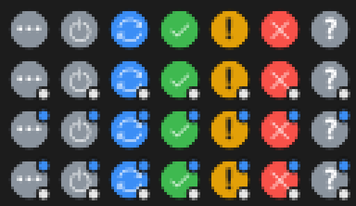

## Painel · Sync pequeno que acabou de acontecer: fica visível por alguns segundos · tema claro

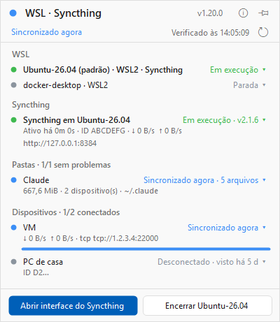

## Painel · Sync pequeno que acabou de acontecer: fica visível por alguns segundos · tema escuro

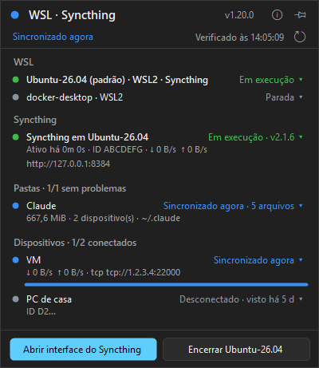

## Painel · Recebendo um arquivo agora (eventos do Syncthing) · tema claro

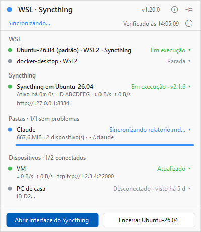

## Painel · Recebendo um arquivo agora (eventos do Syncthing) · tema escuro

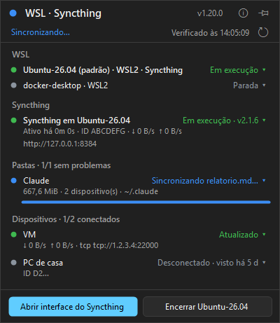

## Painel · Versão nova disponível (botão Atualizar) · tema claro

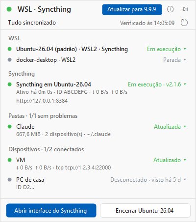

## Painel · Versão nova disponível (botão Atualizar) · tema escuro

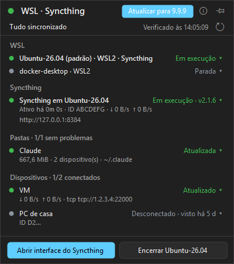

## Painel · Carregando (sem dados ainda) · tema claro

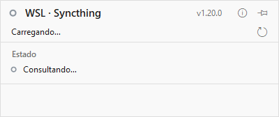

## Painel · Carregando (sem dados ainda) · tema escuro

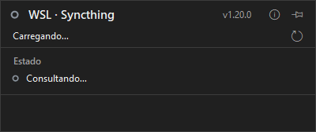

## Painel · Pasta cuja leitura falhou: estado desconhecido (ponto vazado) · tema claro

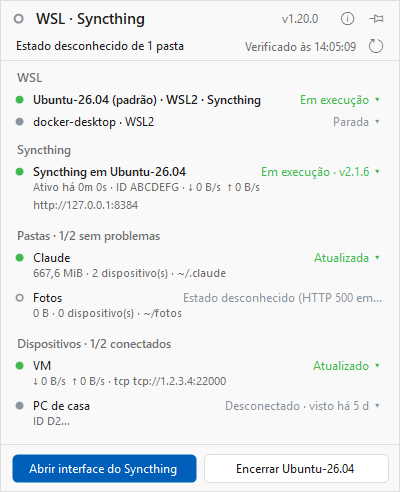

## Painel · Pasta cuja leitura falhou: estado desconhecido (ponto vazado) · tema escuro

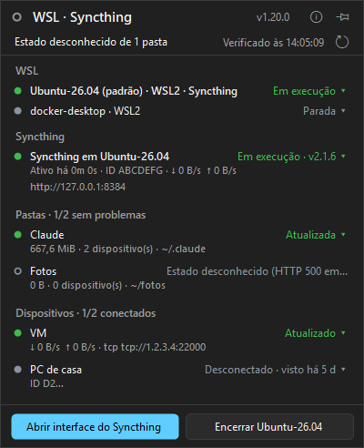

## Painel · Syncthing com chave da API recusada · tema claro

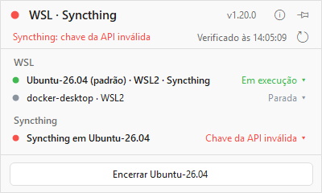

## Painel · Syncthing com chave da API recusada · tema escuro

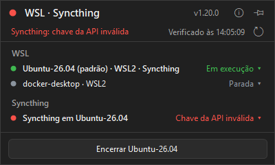

## Painel · Busca de atualização falhou · tema claro

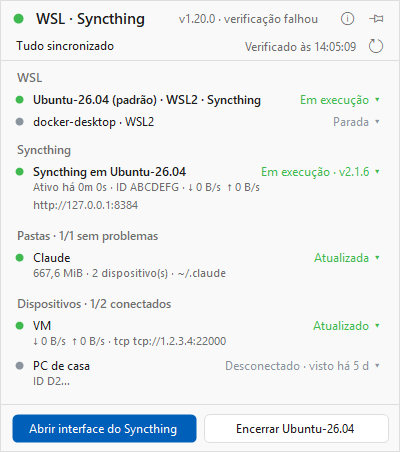

## Painel · Busca de atualização falhou · tema escuro

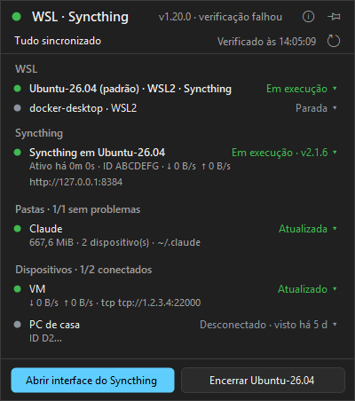

## Painel · Pasta e dispositivo ignorados: seção à parte, sem estado · tema claro

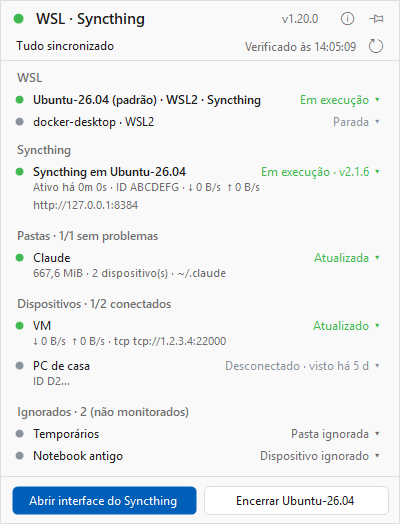

## Painel · Pasta e dispositivo ignorados: seção à parte, sem estado · tema escuro

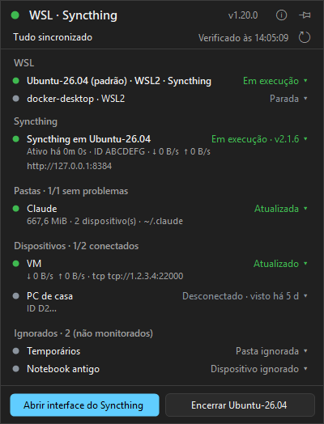

## Painel · Tudo sincronizado (um dispositivo desligado), versão em dia · tema claro

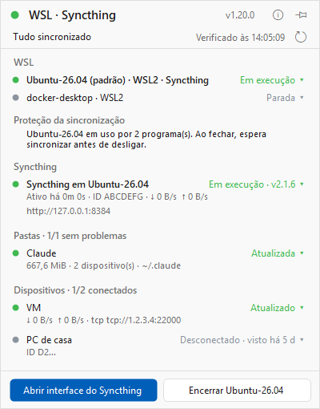

## Painel · Tudo sincronizado (um dispositivo desligado), versão em dia · tema escuro

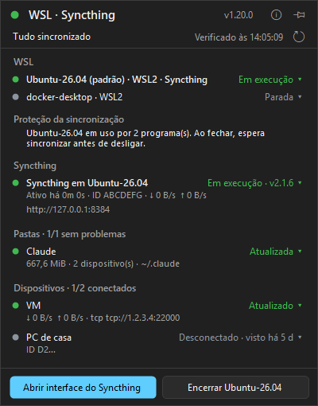

## Painel · Operação longa em andamento (status cortado com reticências) · tema claro

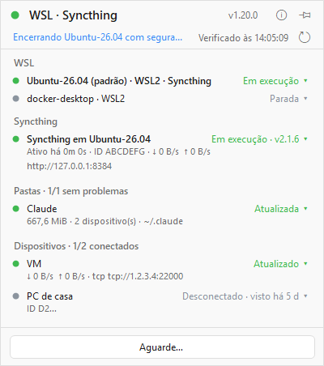

## Painel · Operação longa em andamento (status cortado com reticências) · tema escuro

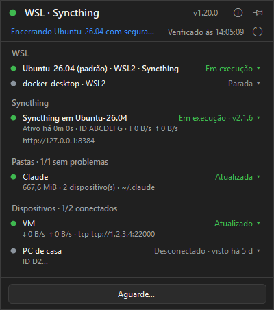

## Painel · WSL parado · tema claro

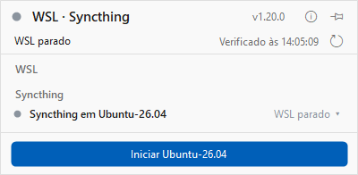

## Painel · WSL parado · tema escuro

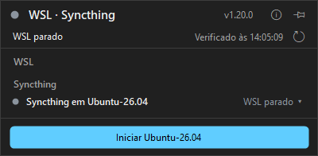

## Painel · Sincronizando uma pasta · tema claro

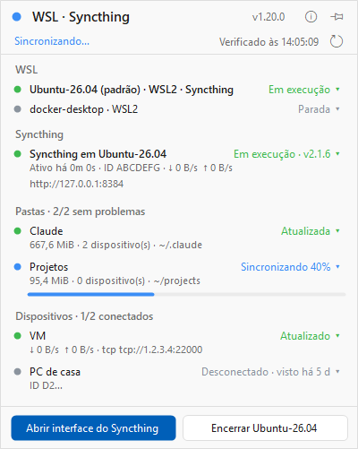

## Painel · Sincronizando uma pasta · tema escuro

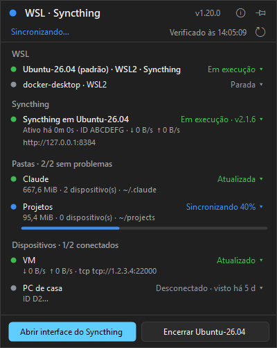

## Painel · wsl.exe não respondeu: estado do WSL desconhecido · tema claro

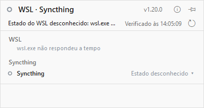

## Painel · wsl.exe não respondeu: estado do WSL desconhecido · tema escuro

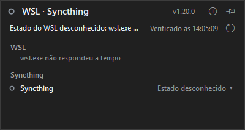

## Widget · carregando · barra-alta (48px) · tema claro (ampliado 2×)

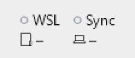

## Widget · carregando · barra-alta (48px) · tema escuro (ampliado 2×)

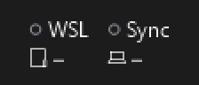

## Widget · pasta com estado desconhecido · barra-alta (48px) · tema claro (ampliado 2×)

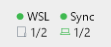

## Widget · pasta com estado desconhecido · barra-alta (48px) · tema escuro (ampliado 2×)

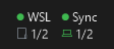

## Widget · tudo certo · barra-alta (48px) · tema claro (ampliado 2×)

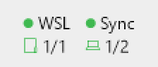

## Widget · tudo certo · barra-alta (48px) · tema escuro (ampliado 2×)

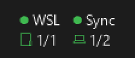

## Widget · WSL parado · barra-alta (48px) · tema claro (ampliado 2×)

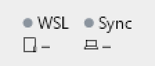

## Widget · WSL parado · barra-alta (48px) · tema escuro (ampliado 2×)

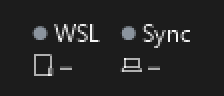

## Widget · sincronizando · barra-alta (48px) · tema claro (ampliado 2×)

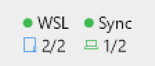

## Widget · sincronizando · barra-alta (48px) · tema escuro (ampliado 2×)

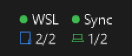

## Widget · WSL sem resposta · barra-alta (48px) · tema claro (ampliado 2×)

## Widget · WSL sem resposta · barra-alta (48px) · tema escuro (ampliado 2×)

## Widget · carregando · barra-baixa (32px) · tema claro (ampliado 2×)

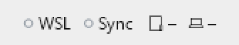

## Widget · carregando · barra-baixa (32px) · tema escuro (ampliado 2×)

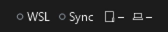

## Widget · pasta com estado desconhecido · barra-baixa (32px) · tema claro (ampliado 2×)

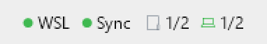

## Widget · pasta com estado desconhecido · barra-baixa (32px) · tema escuro (ampliado 2×)

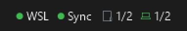

## Widget · tudo certo · barra-baixa (32px) · tema claro (ampliado 2×)

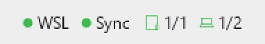

## Widget · tudo certo · barra-baixa (32px) · tema escuro (ampliado 2×)

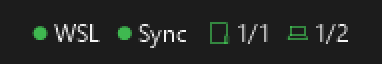

## Widget · WSL parado · barra-baixa (32px) · tema claro (ampliado 2×)

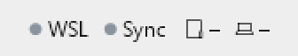

## Widget · WSL parado · barra-baixa (32px) · tema escuro (ampliado 2×)

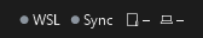

## Widget · sincronizando · barra-baixa (32px) · tema claro (ampliado 2×)

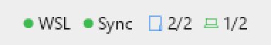

## Widget · sincronizando · barra-baixa (32px) · tema escuro (ampliado 2×)

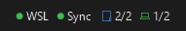

## Widget · WSL sem resposta · barra-baixa (32px) · tema claro (ampliado 2×)

## Widget · WSL sem resposta · barra-baixa (32px) · tema escuro (ampliado 2×)

## Widget · carregando · barra-vertical (48px) · tema claro (ampliado 2×)

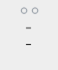

## Widget · carregando · barra-vertical (48px) · tema escuro (ampliado 2×)

## Widget · pasta com estado desconhecido · barra-vertical (48px) · tema claro (ampliado 2×)

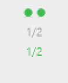

## Widget · pasta com estado desconhecido · barra-vertical (48px) · tema escuro (ampliado 2×)

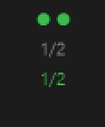

## Widget · tudo certo · barra-vertical (48px) · tema claro (ampliado 2×)

## Widget · tudo certo · barra-vertical (48px) · tema escuro (ampliado 2×)

## Widget · WSL parado · barra-vertical (48px) · tema claro (ampliado 2×)

## Widget · WSL parado · barra-vertical (48px) · tema escuro (ampliado 2×)

## Widget · sincronizando · barra-vertical (48px) · tema claro (ampliado 2×)

## Widget · sincronizando · barra-vertical (48px) · tema escuro (ampliado 2×)

## Widget · WSL sem resposta · barra-vertical (48px) · tema claro (ampliado 2×)

## Widget · WSL sem resposta · barra-vertical (48px) · tema escuro (ampliado 2×)

